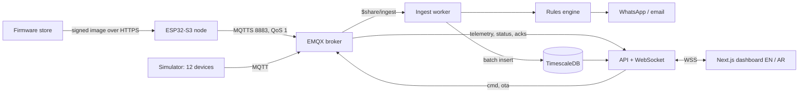

# Nabd (نبض)

**Real-time IoT monitoring with real hardware.** ESP32-S3 sensor nodes on rooftops, farms, clinics and cold
rooms stream readings over MQTT and TLS into TimescaleDB and onto a live dashboard in English and Arabic.
From the browser you can switch a relay and watch the device confirm it, get a WhatsApp message when a
medicine fridge warms past 8 °C, and push signed firmware that rolls itself back if it misbehaves. The
public demo runs a simulated fleet of 12 devices on 4 sites, speaking exactly the firmware's protocol, next
to one real board.

> Status: code complete for every phase. Waiting on hardware tests with the board, a run of the full
> stack in Docker, and deployment. See [docs/PROGRESS.md](docs/PROGRESS.md).


<!-- Relay-flow and live-chart GIF: recorded with Playwright once the stack runs (docs/PROGRESS.md). -->

## How a reading moves



The four hard parts, and where they are solved:

| Problem | Answer | Code |
| --- | --- | --- |
| No lost readings | 5,000-reading flash buffer, replayed with original timestamps at 20/s between live readings; `(device, seq)` makes ingest idempotent | `firmware/nabd-node/lib/nabd_core/src/ring_buffer.cpp`, `apps/ingest/src/batcher.ts` |
| Commands you can trust | Every command has an id and an expiry; the UI shows sent → delivered → confirmed by the device with real timings, or a timeout that restores the true state | `apps/api/src/live/commands.ts`, `apps/web/src/components/app/RelayControl.tsx` |
| Alerts without spam | A pure, table-tested state machine: wait time, hysteresis, cool-down across alerts, quiet hours, escalation | `packages/shared/src/rules.ts` |
| Updates can't brick a box | SHA-256 + ECDSA P-256 checked on the chip, spare OTA slot, kept only after Wi-Fi, MQTT and one publish | `firmware/nabd-node/src/ota.cpp`, `scripts/sign-firmware.ts` |

## Quick start

Requires Node 24, pnpm 10 and Docker.

```bash
cp .env.example .env             # fill in the passwords
pnpm install
pnpm credentials                 # per-device MQTT passwords (gitignored)
pnpm infra:up                    # EMQX + TimescaleDB
pnpm db:migrate && pnpm db:seed
pnpm dev                         # web :3001, api :4000, ingest :4100, simulator :4200
```

Then open http://localhost:3001/fleet. The medicine fridge's door is left open every 20 minutes, so an
alert opens within about 25 minutes of starting.

| Command | What |
| --- | --- |
| `pnpm test` | unit tests (Vitest) for every package |
| `pnpm test:int` | integration tests on a real TimescaleDB (Testcontainers, needs Docker) |
| `pnpm --filter @nabd/web e2e` | Playwright against a running web app; live tests need the stack |
| `pnpm load run --devices 500` | load test ([docs/PERFORMANCE.md](docs/PERFORMANCE.md)) |
| `cd firmware/nabd-node && pio test -e native` | firmware unit tests on the host |

## Layout

| Path | What |
| --- | --- |
| `apps/web` | Next.js 16 marketing site and live dashboard, next-intl (EN + AR RTL), uPlot |
| `apps/api` | Fastify REST + WebSocket gateway: auth, commands, alert rules, OTA, WhatsApp webhook |
| `apps/ingest` | MQTT → TimescaleDB writer, rules engine, notifications |
| `apps/simulator` | 12 virtual devices on 4 sites |
| `packages/shared` | MQTT contract, API types, metric registry, product catalogue, rules state machine |
| `packages/db` | SQL migrations, seed, query helpers |
| `packages/notify` | WhatsApp Cloud API, Resend and console providers |
| `firmware/nabd-node` | PlatformIO firmware for the ESP32-S3 node |
| `infra` | Docker Compose, EMQX auth and ACL, Caddy |
| `docs` | [architecture](docs/architecture.md), [ADRs](docs/adr), [hardware](docs/hardware), [security](docs/SECURITY.md), [deploy](docs/DEPLOY.md), [case study](docs/CASE_STUDY.md) |

Photos on the site are AI-generated for this project, and product photos are concept renders. Demo data
is simulated and labelled as such.

Licence: MIT · Built by [Abanoub Rashad](https://abanoub--rashad.web.app).
