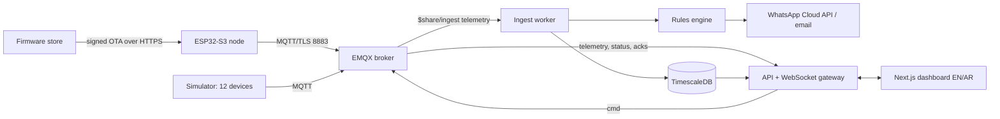

# Architecture

## MQTT contract

Topic root `nabd/v1/{siteSlug}/{deviceId}/…`. The single source of truth is `packages/shared/src/schemas.ts`;
the firmware mirrors it in `firmware/nabd-node/lib/nabd_core/src/payload.cpp`.

| Topic | Direction | QoS | Retained | Notes |
| --- | --- | --- | --- | --- |
| `…/telemetry` | device → cloud | 1 | no | `seq` (persisted), `ts` (SNTP), `m` (registry keys only), `errors`; 2 KB max |
| `…/status` | device → cloud | 1 | yes | online, fw, rssi, uptime, boot reason; Last Will `{"online":false}` |
| `…/cmd` | cloud → device | 1 | no | id, op, args, exp; expired commands are rejected |
| `…/cmd/ack` | device → cloud | 1 | no | `delivered`, then `done` with the real relay state, or `rejected` with a reason |
| `…/ota` | cloud → device | 1 | no | version, https url, sha256, base64 ECDSA P-256 signature |

All clients use MQTT 3.1.1. The contract needs nothing from MQTT 5, the ESP32 client speaks 3.1.1, and EMQX
shared subscriptions work with it.

## Paths

- **Readings:** device → EMQX → ingest (shared subscription, zod validation, 250 ms or 500-row batches) →
  TimescaleDB → `readings_1m/1h/1d`.
- **Live:** EMQX → API (its own subscription) → WebSocket hub → browsers. Each event carries `seq`. A
  client that reconnects sends its last `seq`, and the API back-fills from the database (ADR 0005).
- **Commands:** browser → API (row, publish with expiry, 10 s timer) → EMQX → device → acks → API →
  WebSocket.
- **Alerts:** ingest runs the rules on each reading plus a 30 s clock. Alert changes reach the API by
  Postgres `NOTIFY nabd_alerts`; acknowledgements from the dashboard or WhatsApp come back by
  `NOTIFY nabd_alert_actions`.
- **Firmware:** `scripts/sign-firmware.ts` signs, the API publishes the offer, and the device downloads
  over HTTPS from `fw.<domain>`, verifies, and installs to the spare slot (ADR 0006).

## Decisions

[0001 monorepo](adr/0001-monorepo-layout.md) · [0002 EMQX](adr/0002-mqtt-broker.md) ·
[0003 narrow readings](adr/0003-narrow-readings-table.md) · [0004 migrations](adr/0004-migration-tool.md) ·
[0005 WebSocket fan-out](adr/0005-websocket-fanout.md) · [0006 OTA signing](adr/0006-ota-signing.md) ·
[0007 BLE gateway](adr/0007-ble-gateway.md)
