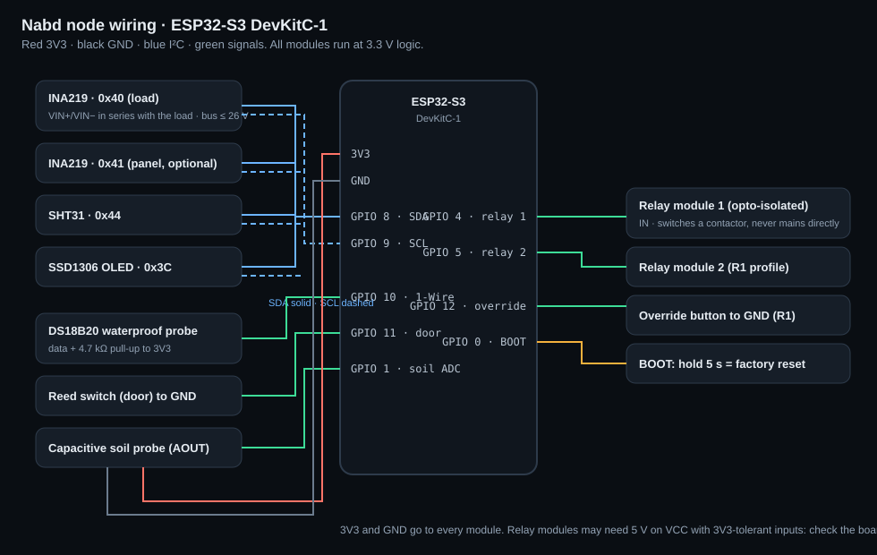

# Nabd node hardware

One ESP32-S3 board, one firmware. The **device profile** (set in the captive portal, stored in NVS) decides
which drivers start and which metrics are published.

| Profile | Product | Sensors | Metrics |
| --- | --- | --- | --- |
| `power` | P1 Power Node | INA219 (load, 0x40), optional second INA219 (panel, 0x41) | `bus_v`, `load_w`, `soc` (estimate), `pv_w` (if fitted), `relay1` |
| `climate` | C1 Climate Node | SHT31 (0x44), capacitive soil probe | `air_c`, `rh`, `soil_pct`, `relay1` |
| `coldchain` | F1 Cold-Chain Probe | DS18B20 waterproof probe, reed switch | `probe_c`, `door` |
| `relay` | R1 Relay Controller | 2 relays, override button | `relay1`, `relay2` |

W1 (pump) and G1 (BLE gateway) are **planned**: see [pump-4-20ma.md](pump-4-20ma.md) and
[ADR 0007](../adr/0007-ble-gateway.md).

## Pins (ESP32-S3 DevKitC-1)

| Signal | GPIO | Notes |
| --- | --- | --- |
| I²C SDA | 8 | INA219, SHT31, SSD1306 share the bus (3V3, 4.7 kΩ pull-ups on most breakouts) |
| I²C SCL | 9 | |
| 1-Wire | 10 | DS18B20 data, 4.7 kΩ pull-up to 3V3 |
| Door reed switch | 11 | to GND, internal pull-up; closed door reads LOW |
| Override button (R1) | 12 | to GND, internal pull-up |
| Soil probe | 1 | ADC1 channel 0 (ADC2 is unusable while Wi-Fi is on) |
| Relay 1 | 4 | opto-isolated relay module input |
| Relay 2 | 5 | |
| BOOT | 0 | hold 5 s for a factory reset |

**Why not GPIO 26:** the brief put the relay on GPIO 26, which is right for the original ESP32. On the
ESP32-S3, GPIO 26–32 are connected to the module's SPI flash, so the relays use GPIO 4 and 5.

## Things to know

- **INA219 bus input tops out at 26 V.** On a 12 V or 24 V system, connect directly. On a 48 V bank, use
  a resistor divider and set `bus_scale` in NVS (for example, 100 kΩ / 47 kΩ gives a scale of 3.13), or
  use an INA226 (36 V), which needs a driver swap.
- **State of charge is an estimate** from bus voltage on a 16-cell LFP curve. It is close only at rest.
  For real coulomb counting, use a BMS that reports SoC (a future driver).
- **Fail-safe:** relays are OFF at boot, and OFF again if the broker is unreachable for `failsafe_s`
  seconds (60 by default). Equipment never stays on because of a dashboard nobody can reach.
- **Offline buffer:** 5,000 readings in LittleFS (about 2.8 hours at 2 s). When full, the oldest is
  dropped and counted.
- **Rollback** needs `CONFIG_BOOTLOADER_APP_ROLLBACK_ENABLE` in the bootloader. It is on in Arduino core
  3.3.12 (see [FLASHING.md](FLASHING.md#rollback)).
